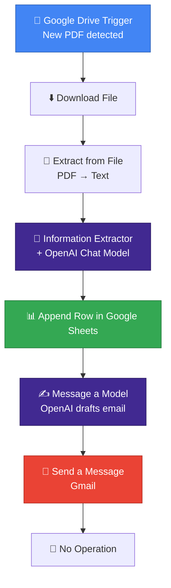

#  Invoice Parser Agent

### Automate invoice extraction, record-keeping and stakeholder alerts end to end.

---

## 📌 Overview

Manual invoice entry is slow, repetitive and error-prone. This project is an **event-driven automation pipeline** built with **n8n** that removes the manual work completely.

The moment a new invoice PDF lands in a Google Drive folder the agent reads it uses **OpenAI** to extract the key financial details logs them into **Google Sheets**, and sends a professional notification email through **Gmail**, all within seconds and with zero human input.

---

## ✨ Key Features

| Feature | Description |
|---|---|
| ⚡ **Event-Driven Trigger** | Starts automatically when a new PDF is created in a watched Google Drive folder. |
| 📑 **PDF Text Extraction** | Converts PDF content to clean text using n8n's built-in extractor, with no external tools required. |
| 🤖 **AI Information Extraction** | OpenAI parses semi-structured invoice text into structured fields such as invoice number, client or sender details, due date, and amounts. |
| 🗂️ **Automatic Record Keeping** | Every processed invoice is appended as a new row in Google Sheets. |
| 📧 **Smart Email Notifications** | A second AI step drafts a formal email, which Gmail sends to billing or stakeholders. |

---

## 🏗️ Architecture & Workflow

### Step-by-Step

1. **Google Drive Trigger**: watches a folder and fires on every new file.
2. **Download File**: fetches the uploaded invoice as binary data.
3. **Extract from File**: turns the PDF into raw text.
4. **Information Extractor**: powered by an OpenAI Chat Model, it returns the invoice data in a strict, structured format.
5. **Append Row in Sheet**: stores the extracted data in Google Sheets.
6. **Message a Model**: generates a polished notification email using the extracted details.
7. **Send a Message (Gmail)**: delivers the email to the relevant recipients.
8. **No Operation**: clean end of the workflow.

---

## 🧰 Tech Stack

- **Automation Platform:** n8n
- **AI Models:** OpenAI (Chat Model + Message a Model)
- **Storage & Trigger:** Google Drive, Google Sheets
- **Notifications:** Gmail

---

## ⚙️ Setup Guide

### Prerequisites
- An [n8n](https://n8n.io) account (cloud or self-hosted)
- An OpenAI API key
- A Google account with Drive, Sheets, and Gmail access

### Installation

1. **Import the workflow**
   Open n8n, click **Import from File**, and select the exported workflow `.json`.

2. **Connect your credentials**
   - Google Drive (OAuth2)
   - Google Sheets (OAuth2)
   - Gmail (OAuth2)
   - OpenAI (API key)

3. **Configure the nodes**
   - Set the **watched folder** in the Google Drive Trigger.
   - Choose your **spreadsheet and sheet** in the Append Row node.
   - Set the **recipient email** in the Gmail node.

4. **Activate**
   Toggle the workflow to **Active**, then upload a sample invoice PDF to test it.

---

## 📊 Sample Output

After each upload, the Google Sheet receives a new row like this:

| Invoice No. | Client / Sender | Due Date | Amount |
|---|---|---|---|
| INV-1001 | Example Co. | 2026-10-30 | 1,250.00 |

> 💡 Add a screenshot of your workflow here: ``

---

## 🔮 Future Improvements

- [ ] Support for scanned invoices and images (OCR)
- [ ] Duplicate invoice detection
- [ ] Error handling with failure alerts
- [ ] Slack / WhatsApp notifications
- [ ] Dashboard for spending analytics

---

## 👩‍💻 Author

**Hamna Asif**
Full-Stack Developer · UI/UX Designer · AI Specialist

---

⭐ If you found this project useful, please give it a star!

